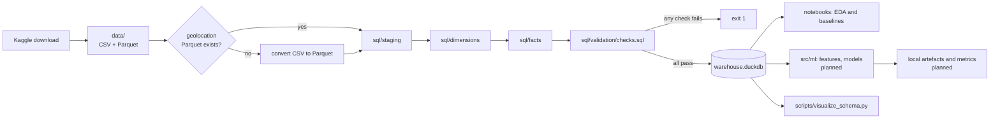

# Architecture

This is a local implementation of what would have been built on BigQuery. It is a batch analytics pipeline on one machine: raw Kaggle files go in, a validated DuckDB star schema comes out, and notebooks and (planned) ML jobs read from it. There is no cloud, server or network service (D-002 and D-005 in [DECISIONS.md](DECISIONS.md)).

## Components

| Component | Path | Responsibility | Status |
|---|---|---|---|
| Raw data | `data/` | The nine Olist files from Kaggle. Immutable: never edited in place. Git-ignored (D-006, D-008). | Built |
| Staging SQL | `sql/staging/` | One view or table per source file. Sets types (zip prefixes as text), fixes misspelled columns and reads the BOM-prefixed translation file. No business logic. | Built |
| Dimension SQL | `sql/dimensions/` | `dim_date`, `dim_geography`, `dim_customer`, `dim_product`, `dim_seller`, each with surrogate keys and an unknown member (DD-05). | Built |
| Fact SQL | `sql/facts/` | `fact_orders`, `fact_order_items`, `fact_payments`, `fact_reviews`, each with one stated grain (DD-01). | Built |
| Validation SQL | `sql/validation/checks.sql` | 22 reconciliation checks against the raw data: row counts, money totals, fan-out and known EDA findings. | Built |
| Build script | `src/transformation/build_warehouse.py` | Deletes and recreates `warehouse.duckdb`. `ensure_geolocation_parquet` converts geolocation CSV to Parquet if needed. `run_sql_file` substitutes `${DATA_DIR}` and runs each file. `main` runs the layers in a fixed order, prints row counts, runs the checks and exits 1 if any fail. | Built |
| Warehouse | `warehouse.duckdb` | The single local database file. Git-ignored and fully reproducible from `data/` and `sql/`. | Built |
| Schema diagram | `scripts/visualize_schema.py` | Draws `docs/data/star_schema.png` from the foreign keys in the database catalogue, so the diagram cannot drift from the DDL. | Built |
| Notebooks | `notebooks/` | `01_dataset_discovery.ipynb` holds the EDA evidence. Later notebooks hold baselines and model evaluation. | Partly built |
| ML layer | `src/ml/`, `sql/ml/` | `late_delivery_features.sql` builds point-in-time features from the warehouse. `late_delivery_baseline.py` and `forecast_baseline.py` run the rolling-origin backtests and write metrics to `reports/`. Design constraints are in [docs/ml/LEAKAGE_ANALYSIS.md](docs/ml/LEAKAGE_ANALYSIS.md); results in [docs/ml/PHASE2_BASELINES.md](docs/ml/PHASE2_BASELINES.md). | Baselines built |
| Tests | `tests/` | 61 pytest tests: geolocation conversion cases, the leakage rules for the feature SQL (on a hand-built mini warehouse), forecast no-lookahead, and recounts against the real warehouse (skipped if it is not built). Run with `uv run pytest`. | Built |

## Data flow

1. **Ingest:** the user downloads the dataset into `data/` ([README.md](README.md), section 1). There is no automated ingestion; the dataset is static (last updated 2021-10-01).
2. **Transform:** `build_warehouse.py` runs staging, then dimensions, then facts. Dimensions come before facts because facts reference them through foreign keys. The order inside each layer is explicit in the script.
3. **Validate:** the checks run in the same process. A failure prints the expected and actual values and the script exits non-zero.
4. **Analyse:** notebooks and the ML layer open the warehouse read-only. Every model input comes from the warehouse, not from the raw files, so all analysis shares one set of grains and cleaning rules.

## Storage

- One DuckDB file, rebuilt from scratch on every run, so there is no migration logic and no state to drift.
- Raw files stay in their Kaggle format, except geolocation, which is converted to Parquet once (DD-06).
- Metrics are written as small JSON files in `reports/`, which are committed so results stay visible. No model artefacts are saved yet; when they are, they go in a git-ignored folder.

## Processing

- Everything is SQL executed by DuckDB, except the geolocation conversion and the ML code, which use Python with pandas and scikit-learn.
- The full build takes about 25 seconds on this laptop (measured 2026-10-11). There is no incremental processing, because the dataset does not change.

## ML (baselines built, D-007)

- **Late-delivery classifier:** one row per order, predicted at purchase. Features are restricted to what is known at the purchase timestamp, and rolling seller and route statistics are computed point-in-time. The data is split by purchase date, not at random. Evaluation uses precision-recall metrics against a naïve baseline (the historical late rate).
- **Weekly order forecast:** weekly order count over the complete weeks of 2017-01 to 2018-08, with revenue as a secondary target. Naïve and moving-average baselines come first, and validation uses rolling origins in time order.
- **Segmentation:** optional, and dropped if it adds little (DD-07).

Feature and leakage rules are in [docs/ml/LEAKAGE_ANALYSIS.md](docs/ml/LEAKAGE_ANALYSIS.md).

## Deployment and monitoring

- **Deployment:** none. The deliverable is a repository that rebuilds the warehouse and reproduces the results with `uv sync` and the commands in the README.
- **Monitoring:** the 22 validation checks act as the data monitor; they run on every build and fail it loudly. Model monitoring will be limited to metrics recorded per run (D-005).

## Security boundaries

- **No network surface:** no services, ports or cloud credentials exist (D-002, D-005).
- **Secrets:** none are needed. `.gitignore` blocks `.env*`, key files and credential JSON files in case one is ever added (D-006).
- **Data:** the dataset is anonymised by Olist. Review text contains free-form customer comments, so it is not republished outside the dataset's terms.
- **Licence:** CC BY-NC-SA 4.0. The data and anything derived from it (warehouse, features, model artefacts) are for non-commercial use, need attribution and must be shared under the same licence if shared at all. `data/` is untracked (D-008), but earlier commits still contain it.

## Failure points

| Failure | Effect | Guard |
|---|---|---|
| A raw file is missing or renamed | Staging fails with a DuckDB error | README lists the nine expected files; the geolocation step raises a clear `FileNotFoundError` |
| Kaggle changes the file schema | Explicit column lists in staging fail, or counts change | Typed `read_csv(... columns=...)` in the eight CSV staging files (geolocation reads Parquet); row-count and money checks |
| Logic error in a transform | Silent revenue or row drift | 22 reconciliation checks; primary-key and foreign-key constraints; the build exits 1 |
| Geolocation conversion from the original Kaggle CSV | Untested path (only tested on a regenerated CSV) | Documented in README; check this step first if the build fails there |
| Notebook started in `notebooks/` uses a relative `data/` path | File not found | Build paths from the repo root |
| `uv` behind a TLS-intercepting network | `uv sync` fails or hangs | Use `uv --native-tls` |
| Leakage in ML features | Overstated model performance | Rules and audit in LEAKAGE_ANALYSIS; time-ordered splits |

## Scalability

- The dataset is about 100k orders and 80 MB on disk. A single DuckDB process handles it with plenty of room, and should cope with one to two orders of magnitude more data on the same laptop.
- Beyond that, the move is to a cloud warehouse. The type mapping, the DuckDB-specific constructs to translate and the likely partition and cluster keys are listed in [docs/data/DATA_MODEL.md](docs/data/DATA_MODEL.md#moving-to-bigquery). That move is out of scope by decision (D-002).

## Cost

$0. Everything runs locally on open-source tools; there is no cloud spend and no paid service. Cloud pricing in Phase 0 was never fully verified and only matters if the cloud phase returns.

## Related documents

- [DECISIONS.md](DECISIONS.md): every decision referenced above.
- [docs/data/DATA_MODEL.md](docs/data/DATA_MODEL.md): grains, keys, columns and design rules.
- [docs/data/EDA_FINDINGS.md](docs/data/EDA_FINDINGS.md): the data-quality evidence.
- [docs/ml/LEAKAGE_ANALYSIS.md](docs/ml/LEAKAGE_ANALYSIS.md): ML targets and leakage rules.
- [docs/phase0/PHASE0_DISCOVERY.md](docs/phase0/PHASE0_DISCOVERY.md): Phase 0 discovery report.
