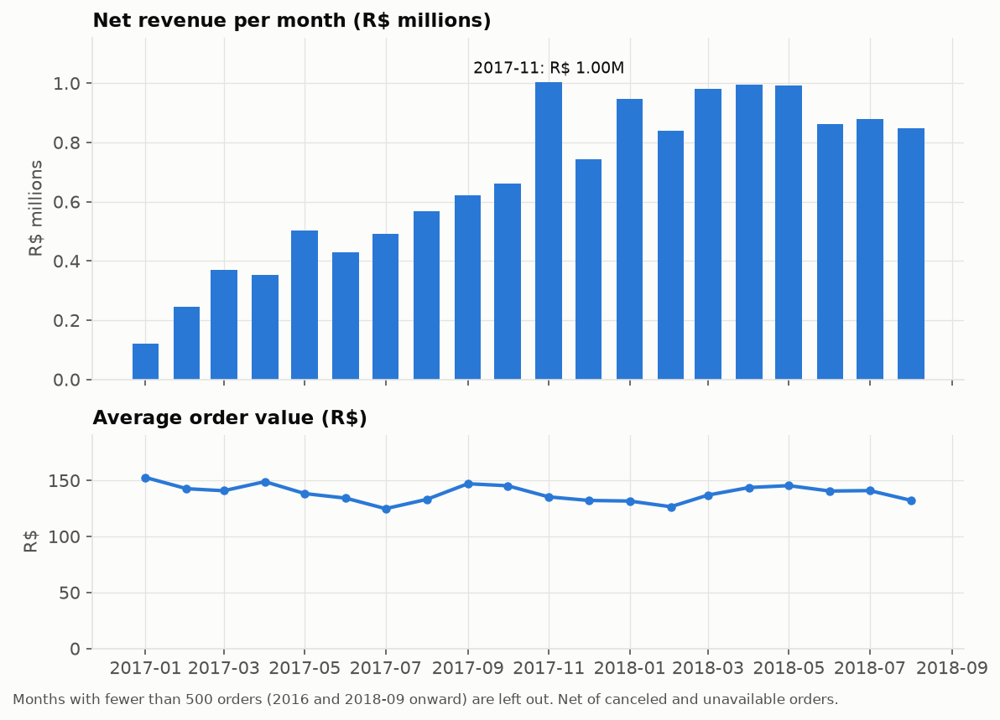
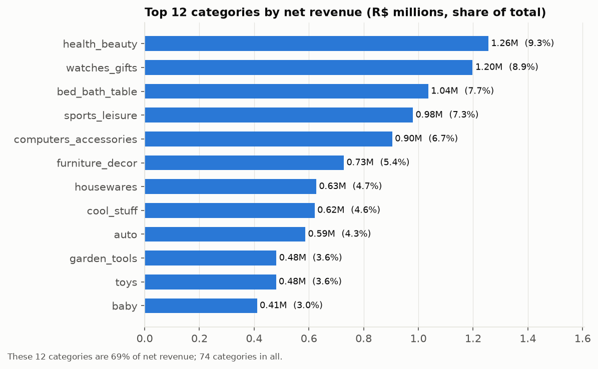
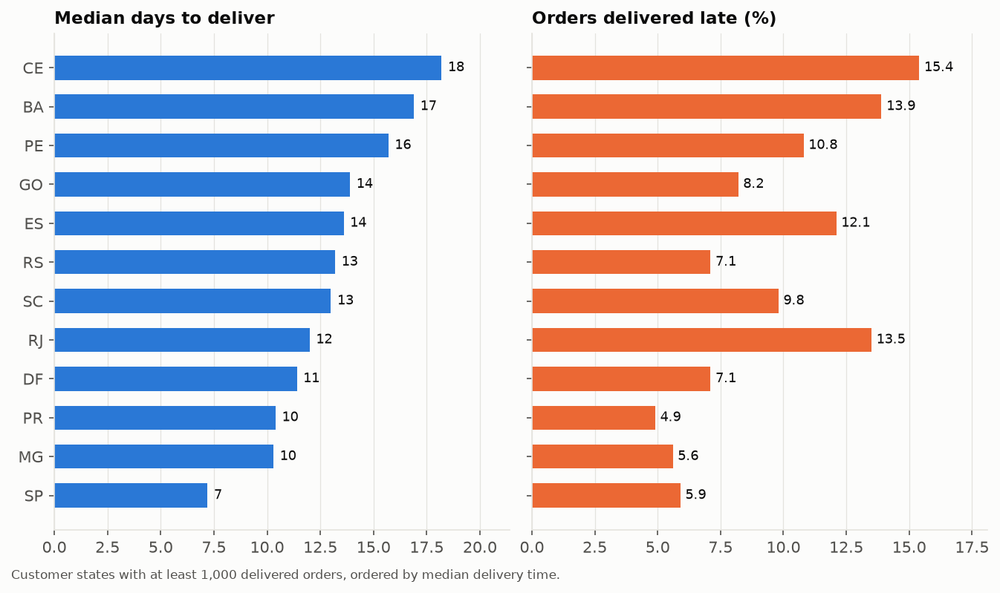
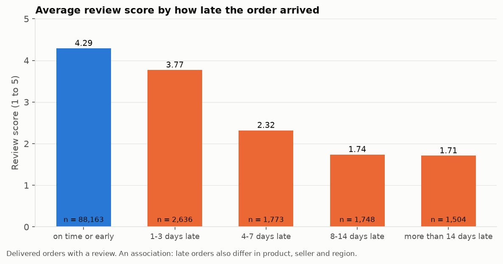
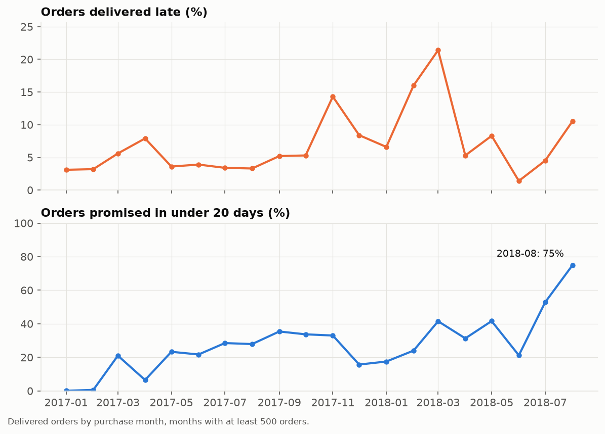

# Business insights: Olist retail analytics

What the data shows about sales, customers, delivery and reviews, from eight SQL queries over the star schema ([sql/analytics/](../../sql/analytics/)). Each query's result is saved in [reports/analytics/](../../reports/analytics/), the charts are drawn by [src/analytics/run_analytics.py](../../src/analytics/run_analytics.py), and [tests/test_analytics.py](../../tests/test_analytics.py) reconciles every table to the fact tables.

**Scope and definitions.** About 99,000 orders placed 2016-09 to 2018-10 on the Olist marketplace (Brazil). *Net revenue* is item price for orders that were not canceled or unavailable: **R$ 13.49 million** over 98,199 orders, an average order value of R$ 137. (The R$ 13.59 million in the discovery report includes canceled and unavailable orders.) Freight adds R$ 2.24 million (16.6% of net revenue) and is reported separately. Months with under 500 orders (2016 and after 2018-08) are left out of trend charts. Everything here is descriptive: where two things move together, the data does not show one causes the other.

## 1. Growth: fast in 2017, flat in 2018

- Average monthly net revenue rose **132%** from February to July 2017 (R$ 0.40 million) to the same months of 2018 (R$ 0.92 million). Most of that happened during 2017; from January 2018 revenue settles in a R$ 0.84 to 1.0 million band.
- **November 2017 is the peak** (R$ 1.00 million, up 52% on October), the month of Black Friday. December fell back 26%. With one such month in the data, how much of November is a recurring seasonal peak cannot be told.
- **Order value is steady**: R$ 125 to 153 in every month of the period. Growth came from more orders, not bigger baskets (about 1.1 items per order throughout).

## 2. What sells: broad, and not concentrated in a few categories

- 74 categories; the top five (health_beauty, watches_gifts, bed_bath_table, sports_leisure, computers_accessories) are 40% of net revenue, the top ten 62%. No single category exceeds 9.3%.
- **Freight is a larger burden for bulky and cheap goods**: freight is 29.5% of price for electronics (average item R$ 57), 25.0% for office_furniture and 23.7% for furniture_decor, against 8.4% for watches_gifts (average item R$ 201).
- **Office furniture is the weakest large category for reviews** (3.49 average against 4.15 for health_beauty and 4.33 for luggage_accessories), with a high freight share (25%) and a late rate near the average (8.9%). The data does not say why.

## 3. Geography: one region carries the marketplace, and the north-east pays for distance

- **São Paulo is 38% of net revenue**, with Rio de Janeiro (13%) and Minas Gerais (12%), together 63% of the total.
- **Delivery gets slower and less reliable away from São Paulo.** The median delivery takes 7 days in SP, 10 in MG and PR, and 17 to 21 in BA, CE, PA and MA.
- **Rio de Janeiro is the outlier**: its median delivery time (12 days) is middling, but 13.5% of its orders arrive late, almost the rate of far-away BA (13.9%) and CE (15.4%), and RJ has 12,337 delivered orders. That looks like a problem with the promise (or a specific carrier lane) more than with distance.
- **Maranhão is the worst**: 19.5% late, a 19-day median delivery, and freight at 26.4% of price.
- Remote customers pay more for freight (about 20% to 26% of price in the north-east, against 13.8% in São Paulo) and wait longer.

## 4. Seller base: a long tail with a strong head

- 3,053 sellers earned net revenue. The **top 10 sellers are 13.2% of revenue and the top 10% are 67.5%**; the top half is 96.8%. The largest single seller is 1.7%. The median seller sold R$ 825 in total.
- So the marketplace does not depend on one seller, but about 300 sellers carry two thirds of revenue, and their service quality largely sets the marketplace's.

## 5. Delivery and reviews: lateness is the clearest cost to customer satisfaction

- **92% of delivered orders arrive on time or early, and average 4.29 stars.** An order that is 1 to 3 days late averages 3.77, 4 to 7 days 2.32, and 8 days or more about 1.7. About 78% of orders that arrive 8 or more days late get 1 or 2 stars, against 9.2% of on-time orders.
- The penalty is steep after a few days. About 5,000 of the 95,800 reviewed delivered orders (5.2%) arrive more than 3 days late, and they produce roughly 30% of all 1 and 2 star reviews. The other 70% still come from orders delivered on time or within 3 days, because there are so many more of them, so lateness is a large driver of low scores but far from the only one.
- This is an association: late orders also differ in product, seller and region (the late rate varies from 5% to 20% across states).

## 6. The delivery promise changed, and it is the main story of 2018

- The **late rate is volatile**: 3% to 8% for most of 2017, then 14% in November 2017, 16% in February 2018 and **21% in March 2018**, before dropping to 1.4% in June 2018.
- **From mid-2018 the promised delivery window shortened sharply.** The share of delivered orders promised in under 20 days rose from 21% in June to 53% in July and **75% in August 2018** (average promise 15 days, down from about 24). At the same time actual delivery got faster (median 7.0 days in August against 8 to 14 in the first half of 2018), but the promise shortened by more.
- The result: the late rate climbed again to 10.5% in August even as deliveries sped up. A tighter promise means more chances to miss it. The data does not say why the promise changed (policy, a new estimator or a different mix of sellers are all possible).
- This is the same change that broke the late-delivery model's ranking in August (see [../ml/DRIFT_ANALYSIS.md](../ml/DRIFT_ANALYSIS.md)). (That analysis counts all non-canceled orders and finds 72% promised in under 20 days; this chart counts delivered, labelled orders and finds 75%.)

## 7. Customers: almost everyone buys once

- **97.0% of customers (92,096 people) placed one order**, 2.8% two, and 0.25% three or more. Repeat customers are 3.0% of customers and **5.6% of net revenue**.
- Growth therefore depends on acquiring new customers, not on bringing buyers back, and customer-lifetime or retention modelling has little to work with. This is also why customer segmentation (DD-07) was not pursued.

## 8. Payments

- **Credit cards are 78% of payment value** (average payment R$ 163, about 3.5 instalments), and *boleto* (a Brazilian bank slip) 18%. Vouchers (2.4%) and debit cards (1.4%) are small. Payment totals are analysed on their own and do not exactly tie to item revenue (DD-04).

## What this suggests

These are hypotheses to test, not conclusions the data proves.

1. **Review the delivery promise.** Short promises met more often would protect satisfaction: late orders drive most low scores, and in August 2018 the shorter promise raised the late rate even though delivery sped up. A promise set from each route's recent delivery times (the slack idea tried in the ML work) is the natural fix, though it did not improve the model's predictions.
2. **Look at Rio de Janeiro and the north-east separately.** RJ misses promises at nearly the rate of the most distant states while delivering in a middling time, which points at the promise or at a specific carrier lane. Maranhão and Ceará have the worst combination of delay and freight burden.
3. **Watch freight on bulky goods.** For electronics, furniture and housewares freight is 22% to 30% of the item price; this is a plausible conversion barrier, which the data cannot test.
4. **Protect the top sellers.** About 300 sellers produce two thirds of revenue.
5. **Do not plan around repeat purchases.** With 97% single-order customers, acquisition and the first delivery experience are the levers.

## Limits

- One marketplace, one period (2016-09 to 2018-10), and only about 21 months with real volume.
- Net revenue excludes canceled and unavailable orders but takes no account of returns or refunds, which the dataset does not record.
- Category late rates and review scores are weighted by item, not order, so multi-item orders count more than once.
- Review scores come from customers who chose to review; they are not a random sample.
- The query for state performance keeps orders with items, so the order counts differ slightly from the discovery report's.
