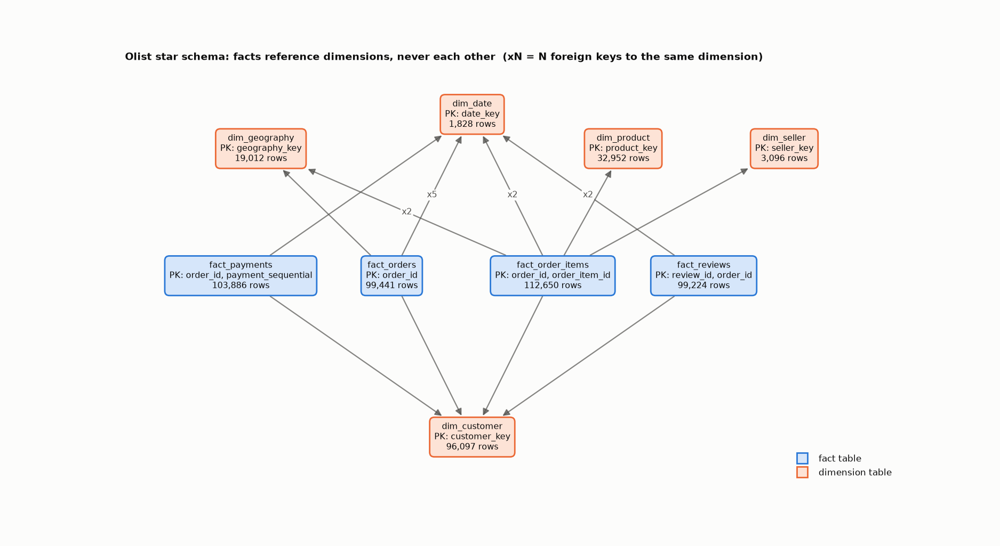
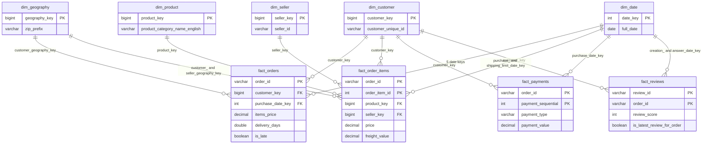

# Data model: Olist star schema

A Kimball-style star schema over the nine raw Olist files, built locally in DuckDB. It is derived from the evidence in [EDA_FINDINGS.md](EDA_FINDINGS.md) and `notebooks/01_dataset_discovery.ipynb` (section 9 lists the decision behind every choice below).

- **Rebuild:** `uv run python src/transformation/build_warehouse.py` creates `warehouse.duckdb` from `data/` and `sql/`, then runs 22 reconciliation checks against the raw data. It exits non-zero if any fail.
- **Redraw the diagram:** `uv run python scripts/visualize_schema.py` regenerates the image below from the foreign keys in the database catalogue, so it cannot drift from the DDL.

## Entity-relationship diagram

Only keys are shown; each table's full column list is in `sql/dimensions/` and `sql/facts/`. `dim_date` and `dim_geography` are role-playing: one dimension referenced several times by the same fact.

## Design rules

1. **Facts never join to facts.** Items, payments and reviews hang off `order_id` at different grains; joining them side by side repeated rows and overstated item revenue by 4.54% (5.02% with reviews) in the EDA. Facts meet only through shared dimensions, or are aggregated to a common grain first (`fact_orders` does this for items and payments).
2. **Every table has one stated grain.** Counting orders from `fact_order_items` needs `count(distinct order_id)`.
3. **Surrogate keys on every dimension**, assigned deterministically (`row_number()` over the natural key), plus an **unknown member (key -1)** so a failed lookup never drops a fact row. `dim_date` uses the readable key `yyyymmdd` and `-1` means "not applicable" (a missing milestone date).
4. **Revenue comes from `fact_order_items` only.** Payments do not always equal items + freight (380 of 98,665 orders differ, mostly instalment orders), so `fact_payments` is analysed on its own and never forced to tie.
5. **Low-cardinality attributes stay on the fact** (`order_status`, 8 values; `payment_type`, 5 values). No dimension is created just to satisfy the textbook form.
6. **Nothing is silently dropped or altered.** Anomalies are kept and flagged (`has_timestamp_anomaly`), and unmatched lookups map to the unknown member.

## Dimensions

| Table | Grain | Key | Rows | Notes |
|---|---|---|---|---|
| `dim_customer` | one real customer (`customer_unique_id`) | `customer_key` | 96,097 | Source `customer_id` is per order (99,441 ids for 96,096 people). City/state come from the customer's most recent order; 250 customers changed location, so the location at the time of each order is carried on the facts instead. |
| `dim_product` | one product | `product_key` | 32,952 | English category falls back to the Portuguese name (13 products with no translation), then to `unknown` (610 products with no category). Fixes the source's `lenght` typos. Adds `product_volume_cm3`. |
| `dim_seller` | one seller | `seller_key` | 3,096 | Straight from the source. |
| `dim_geography` | one zip-code prefix | `geography_key` | 19,012 | ~1M geolocation points collapsed to one row per prefix: median latitude/longitude, most frequent city/state. 31 points outside Brazil are excluded. Role-played as customer and seller location. |
| `dim_date` | one calendar day | `date_key` (`yyyymmdd`) | 1,828 | A generated calendar of whole years, 2016-2020, not derived from order dates: 2016-11 has no orders but must exist, and 4 items carry a 2020 shipping limit date. Role-played by the facts' date keys. |

Row counts include the unknown member (the 1,828 dates are 1,827 days plus the -1 row).

## Facts

### `fact_order_items` - the core sales fact

| | |
|---|---|
| **Grain** | one order item: (`order_id`, `order_item_id`) |
| **Rows** | 112,650 |
| **Foreign keys** | `customer_key`, `product_key`, `seller_key`, `customer_geography_key`, `seller_geography_key`, `purchase_date_key`, `shipping_limit_date_key` |
| **Measures** | `price`, `freight_value`, `item_total_value` (price + freight), all `DECIMAL(12,2)`, additive |
| **Degenerate** | `order_id`, `order_item_id`, `order_status` (copied so revenue can be filtered by status without another fact) |
| **Source** | `stg_order_items` joined one-to-one to `stg_orders`, `stg_customers`, `stg_sellers` and the dimensions |

### `fact_orders` - order lifecycle

| | |
|---|---|
| **Grain** | one order: `order_id`. Keeps all 99,441 orders, including the 775 with no items |
| **Foreign keys** | `customer_key`, `customer_geography_key`, and five role-playing dates: `purchase_`, `approved_`, `carrier_`, `delivered_customer_`, `estimated_delivery_date_key` |
| **Measures** | `item_count`, `items_price`, `items_freight`, `payment_count`, `payment_total` (items and payments pre-aggregated to the order grain before joining); `delivery_days` (purchase to delivery, fractional days), `delivery_delay_days` (delivered minus estimated; positive = late) |
| **Flags** | `is_late` (delivered after the estimate; null if no delivery date), `has_timestamp_anomaly` (carrier before purchase, or customer delivery before carrier) |
| **Degenerate** | `order_id`, `customer_id` (the source per-order id), `order_status`, and the raw timestamps (nullable) |
| **Source** | `stg_orders`, with `stg_order_items` and `stg_order_payments` aggregated first |

### `fact_payments` - payments

| | |
|---|---|
| **Grain** | one payment: (`order_id`, `payment_sequential`) |
| **Rows** | 103,886 |
| **Foreign keys** | `customer_key`, `purchase_date_key` (payments have no date of their own, so the order's purchase date is used) |
| **Measures** | `payment_value` (`DECIMAL(12,2)`), `payment_installments` |
| **Degenerate** | `order_id`, `payment_sequential`, `payment_type` |

### `fact_reviews` - reviews

| | |
|---|---|
| **Grain** | one review: (`review_id`, `order_id`). `review_id` alone is not unique (789 ids span several orders), and 547 orders have 2-3 reviews |
| **Rows** | 99,224 |
| **Foreign keys** | `customer_key`, `review_creation_date_key`, `review_answer_date_key` |
| **Measures** | `review_score` (1-5) |
| **Flags** | `is_latest_review_for_order` (use this, or aggregate first, before relating reviews to orders), `has_comment` |
| **Degenerate** | `review_id`, `order_id`, comment title and message (nullable text; 58.7% of messages are null), raw timestamps |

## Validation

`sql/validation/checks.sql` returns one row per check, and the build fails if any is false. Primary-key uniqueness and foreign-key coverage are enforced by the table constraints. The checks cover:

- every fact keeps every source row (4 row-count checks), and every dimension holds one row per natural key (4);
- money reconciles exactly: items price, freight and item total, payment value, and the order-level roll-ups (6);
- joining the item fact to all six dimension roles leaves revenue unchanged, which is the fan-out check;
- the EDA findings hold in the model: 775 item-less orders kept, 7,827 late deliveries, anomaly flags, one latest review per reviewed order, 279 orders with an unmatched customer zip on the unknown geography member (5);
- the calendar has no gaps and includes 2016-11 (2).

## Moving to BigQuery

The DDL uses types that map directly, but the SQL needs dialect translation rather than copy-paste. This is not applied yet. The full plan, with the constructs counted per file, the `ASOF JOIN` problem and the numbers to reproduce, is in [docs/MIGRATING_TO_CLOUD.md](../MIGRATING_TO_CLOUD.md).

| DuckDB | BigQuery |
|---|---|
| `VARCHAR` | `STRING` |
| `INTEGER`, `BIGINT` | `INT64` |
| `DECIMAL(12,2)` | `NUMERIC` |
| `DOUBLE` | `FLOAT64` |
| `BOOLEAN` | `BOOL` |
| `DATE` | `DATE` |
| `TIMESTAMP` (no time zone) | `DATETIME` |

- Primary and foreign keys are informational in BigQuery (`NOT ENFORCED`); the validation queries become the real guard there.
- DuckDB-specific constructs to translate: `read_csv(... columns = {...})` (replaced by an external or loaded table), the `${DATA_DIR}` token, `median`, `generate_series`, `strftime`, `date_diff`, `isodow`, `weekofyear`, `monthname`, and inline `REFERENCES`.
- Likely partition and cluster choices, to be confirmed against real query patterns: partition `fact_orders` by purchase date and `fact_order_items` by `purchase_date_key`; cluster on the most-filtered keys (`customer_key`, `seller_key`, `product_key`).
